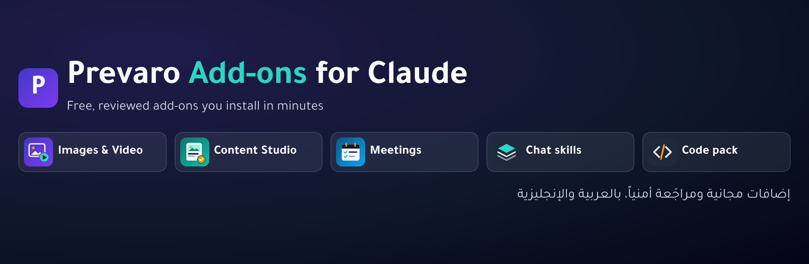

<p align="center"></p>

# Prevaro Add-ons for Claude

**العربية** | [English](#english) · [إخلاء المسؤولية](DISCLAIMER.md) · [الرخصة: MIT](LICENSE)

## ما هذا؟
**إضافات مجانية ومفتوحة المصدر لـClaude**، تجعله يولّد الصور والفيديو، ويدير محتوى وسائل التواصل، ويصمم صفحات وملصقات، ويقرأ مخططات CAD. تختار منها ما تحتاجه، وكل واحدة تُثبَّت في دقائق وتُزال بسهولة.

- **لمن؟** لمن يستخدم Claude في عمله ولا يريد أن يبرمج: أصحاب الشركات، المسوّقون، المصممون، المهندسون. وللمبرمجين في Claude Code.
- **بكم؟** الإضافات مجانية. ما تدفعه، إن دفعت، يذهب مباشرة للخدمة التي تربطها بمفتاحك أنت (مثل Google Gemini). لا خادم وسيط ولا اشتراك عندنا.
- **هل هي آمنة؟** كل مكوّن مراجَع ومثبّت على إصدار محدد، والمراجعات منشورة في [reviews/](reviews/). مفاتيحك تبقى على جهازك.
- **بأي لغة؟** الشرح بالعربية والإنجليزية، والإضافات تعمل باللغتين.

**Prevaro** مشروع أداة تصميم بالذكاء الاصطناعي لمخططات وتقارير أنظمة التيار الخفيف (ELV). هذه الإضافات أول جزء منشور منه.

## ماذا في الداخل؟
| الإضافة | ما فيها | الخدمات والأدوات التي تدعمها |
|---|---|---|
|  **Gemini Images & Video** | 5 أدوات: توليد صورة، تعديل صورة، توليد فيديو، متابعة المهمة، عدّاد الصرف | Google Gemini (بمفتاحك) · Claude Desktop على Mac و Windows |
|  **Content Studio** | 7 مهارات: إعداد الهوية، مسؤول المحتوى، خطة وتقويم، تركيب صورة المنشور، التسليم للنشر، تقرير الصباح، توليد الصور. و3 إضافات ربط اختيارية | Typefully · Buffer · Metricool (بمفتاحك أو بتسجيل الدخول) · Claude Desktop (Cowork) و Claude Code |
| **مهارات للمحادثة** | 7 مهارات: صفحات ويب، ثيمات، ملصقات، رسمان خطيان تفاعليان، بناء خوادم MCP، مهارة Gemini | claude.ai في المتصفح والتطبيق |
| **حزمة Claude Code** | 12 مهارة، 9 وكلاء متخصصين، خادم CAD، وبلغنز فيديو | Playwright · HyperFrames · Remotion · مخططات DWG و DXF · Firecrawl و Perplexity (اختياريان، بمفتاحك) · Claude Code على Mac و Windows و Linux |

## اختر ما تحتاجه
| | الإضافة | ماذا تضيف لـClaude | أين تعمل | التثبيت |
|---|---|---|---|---|
| **1** | [**Gemini Images & Video**](#1-gemini-images--video) | توليد الصور وتعديلها وتوليد فيديو قصير عبر Google Gemini، بمفتاحك | تطبيق Claude Desktop على **Mac و Windows** | ملف واحد يُفتح بنقرتين |
| **2** | [**مهارات للمحادثة**](#2-مهارات-للمحادثة) | 7 مهارات: صفحات ويب، ثيمات، ملصقات، رسوم خطية تفاعلية، ومهارة مرافقة لإضافة Gemini | Claude في المتصفح أو التطبيق | رفع ملف ZIP، بلا تثبيت |
| **3** | [**حزمة Claude Code**](#3-حزمة-claude-code) | مهارات تصميم وفيديو، قراءة مخططات CAD، 9 وكلاء متخصصين | Claude Code على Mac و Windows و Linux | أمر واحد |
| **4** | [**Content Studio**](#4-content-studio) | مسؤول محتوى لوسائل التواصل: خطة، صورة المنشور بشعارك وخطك، تسليم للاعتماد، وتقرير صباحي عن حساباتك ومنافسيك | تطبيق Claude Desktop (Cowork) و Claude Code | ملف بلغن واحد، أو أمران |

لا تعرف من أين تبدأ؟ إن كنت تستخدم تطبيق Claude على حاسوبك فابدأ بالأولى.

---

## 1. Gemini Images & Video
تقول لـClaude «ولّد صورة لـ…» أو «عدّل هذه الصورة واجعل الخلفية بيضاء» أو «اصنع مقطعاً من 5 ثوانٍ لـ…»، فيولّدها عبر Google Gemini ويحفظها في مجلد على جهازك.

**التنزيل:**
- الإضافة: [gemini-media-1.0.1.mcpb](https://github.com/moutaz990/Prevaro-Add-ons-for-Claude/raw/main/gemini-media/gemini-media-1.0.1.mcpb) (الملف نفسه لـMac و Windows)
- دليل التثبيت PDF، عربي وإنجليزي: [gemini-media-install-guide-ar-en.pdf](https://github.com/moutaz990/Prevaro-Add-ons-for-Claude/raw/main/gemini-media/gemini-media-install-guide-ar-en.pdf)

**التثبيت في ثلاث خطوات:**
1. نزّل ملف الإضافة وافتحه **بنقرتين**، ثم اضغط **Install** في نافذة Claude Desktop.
2. الصق **مفتاح Gemini API** (من <https://aistudio.google.com/apikey>، لمشروع مفعّل فيه الدفع)، واختر مجلد الحفظ والحد الشهري للصرف.
3. افتح محادثة جديدة واطلب صورة.

**ما يجب أن تعرفه:**
- الصرف على **مفتاحك أنت** لدى Google: نحو 0.04 دولار للصورة، ونحو 0.10 دولار لكل ثانية فيديو. تضع حداً شهرياً لا تتجاوزه الإضافة.
- مفتاحك يبقى في التخزين الآمن لنظامك، ويُرسل إلى Google فقط. لا خادم وسيط.
- الأوصاف والصور التي تطلب تعديلها تُرسل إلى Google. لا ترسل بيانات عملاء أو بيانات شخصية.
- **لم تُجرَّب بعد داخل Claude Desktop حقيقي ولا بمفتاح حقيقي.** هي مختبَرة آلياً فقط، فجرّب صورة واحدة أولاً.

**مهارة مرافقة (اختيارية، موصى بها):** [gemini-visual-generation.zip](https://github.com/moutaz990/Prevaro-Add-ons-for-Claude/raw/main/chat-skills/gemini-visual-generation.zip) تعلّم Claude مقاسات المنشور والستوري والأغلفة، وكتابة وصف جيد، وعرض التكلفة قبل أي فيديو. ترفعها من **Customize ← Skills ← Upload a skill**.

الشرح الكامل، وحل المشاكل، والكود المصدري: [gemini-media/](gemini-media/).

---

## 2. مهارات للمحادثة
7 ملفات ZIP جاهزة للرفع إلى Claude Chat، دون تثبيت أي شيء على الحاسوب: تصميم صفحات ويب، ثيمات، ملصقات، بناء خوادم MCP، رسوم خطية تفاعلية، ومهارة مرافقة لإضافة Gemini.

1. نزّل الملف من [chat-skills/](chat-skills/) (افتحه في GitHub ثم اضغط **Download raw file**).
2. في claude.ai: **Customize ← Skills ← + ← Upload a skill**، واختر ملف ZIP كما هو دون فك الضغط.
3. فعّل المهارة واطلب منها ما تريد.

التفاصيل: [chat-skills/README.md](chat-skills/README.md).

---

## 3. حزمة Claude Code
إضافات جاهزة لـ **Claude Code** تجعله أقوى في تصميم المواقع، والفيديو، وقراءة مخططات CAD، ومراجعة الكود، والجلسات الطويلة. الفوائد بالتفصيل: [GUIDE.md](GUIDE.md).

### المحتوى
| المجال | ما يضيفه |
|---|---|
| تصميم مواقع | 7 مهارات + Playwright (Claude يفتح الصفحة ويلتقط صوراً ويصحح) |
| رسومات وهوية | ملصقات، ثيمات، رسوم خطية تفاعلية |
| فيديو | HyperFrames و Remotion: فيديو موشن بالكود إلى MP4 |
| مخططات CAD | خادم `cad`: فتح DWG/DXF، استعلام، قياس، تعديل، تصدير DXF |
| وكلاء متخصصون (9) | واجهات، backend، مراجعة كود، أمن الكود المولّد، شبكات، UI، UX، هوية، محتوى |
| جلسات طويلة | auto-handoff (مثبّت **معطّل** افتراضياً: يقاطع المهمة الجارية ولا يطلب موافقتك). الأوامر اليدوية `/compact` و`/resume` و`/rewind` تكفي |
| بحث (اختياري) | Firecrawl و Perplexity بمفتاحك المدفوع |

### المتطلبات
| البرنامج | Windows | macOS |
|---|---|---|
| Claude Code 2.1.275+ | `irm https://claude.ai/install.ps1 \| iex` | `curl -fsSL https://claude.ai/install.sh \| bash` |
| Node.js 22+ | `winget install OpenJS.NodeJS.LTS` | `brew install node@22` |
| Git 2.25+ | `winget install Git.Git` | `xcode-select --install` |
| ffmpeg (اختياري، للفيديو) | `winget install Gyan.FFmpeg` | `brew install ffmpeg` |
| Chrome أو Edge (موصى به) | Edge موجود في Windows | أي منهما |

السكربت يفحص كل ذلك أولاً، ولا يغيّر شيئاً إن نقص المطلوب.

### التثبيت على Windows
**أمر واحد يجهّز كل شيء** (يثبّت Git و Node و ffmpeg و Claude Code إن نقصت، ثم الحزمة). افتح PowerShell والصق:
```powershell
irm https://raw.githubusercontent.com/moutaz990/Prevaro-Add-ons-for-Claude/main/install/bootstrap.ps1 | iex
```
- سيسألك عن مفاتيح API اختيارية: Gemini و Firecrawl و Perplexity. **اترك أي حقل فارغاً واضغط Enter للتخطي.**
- إن ظهرت نافذة صلاحيات Windows (UAC) اضغط **Yes**.
- بعد الانتهاء افتح PowerShell جديداً واكتب `claude`، وسجّل الدخول أول مرة.

**أو يدوياً بعد تثبيت المتطلبات:**
```powershell
git clone https://github.com/moutaz990/Prevaro-Add-ons-for-Claude.git "$HOME\prevaro-addons"; powershell -ExecutionPolicy Bypass -File "$HOME\prevaro-addons\install\install.ps1"
```

### التثبيت على Mac (و Linux)
ثبّت المتطلبات من الجدول أعلاه، ثم افتح Terminal والصق:
```bash
git clone https://github.com/moutaz990/Prevaro-Add-ons-for-Claude.git ~/prevaro-addons && bash ~/prevaro-addons/install/install.sh
```

### ملاحظات التثبيت
- **للفحص فقط دون أي تغيير:** أضف `-CheckOnly` على Windows أو `--check-only` على Mac.
- **أسئلة المفاتيح:** اختيارية، واضغط Enter للتخطي. مفتاح Perplexity يتطلب شحن رصيد مسبق.
- **بعد الانتهاء:** افتح Terminal جديداً واكتب `claude`.
- **لا تحذف ولا تنقل مجلد `prevaro-addons` بعد التثبيت:** البلغنات المثبّتة منه (ومنها auto-handoff المعطّل) تُقرأ منه.

### التحديث والإزالة
Windows:
```powershell
cd "$HOME\prevaro-addons"; git pull; powershell -ExecutionPolicy Bypass -File .\install\install.ps1
```
```powershell
powershell -ExecutionPolicy Bypass -File "$HOME\prevaro-addons\install\uninstall.ps1"
```
Mac:
```bash
cd ~/prevaro-addons && git pull && bash install/install.sh
```
```bash
bash ~/prevaro-addons/install/uninstall.sh
```

- الإزالة تحذف كل ما أُضيف وتعيد `settings.json` كما كان.
- النسخ الاحتياطية تبقى في مجلد `prevaro-claude-setup/backups`.

### أين تعمل؟
| المكان | المهارات | الوكلاء والبلغنز وخوادم MCP |
|---|---|---|
| Claude Code: Terminal، أو قسم Code في تطبيق Claude للكمبيوتر، أو VS Code | ✅ تلقائياً | ✅ |
| Claude Chat (claude.ai، الجوال) | ✅ برفع ZIP يدوي ([GUIDE.md](GUIDE.md#chat)) | ❌ |

---

## 4. Content Studio
بلغن يجعل Claude مسؤول محتوى لوسائل التواصل، لأي شركة: تحفظ هويتك مرة واحدة (الشعار، الألوان، الخط)، ثم يخطط المحتوى، ويركّب صورة المنشور النهائية بمقاسات المنصات، ويسلّمك كل منشور للاعتماد، ويعطيك تقريراً صباحياً عن حساباتك ومنافسيك.

**التنزيل:** [content-studio-0.2.0.plugin](https://github.com/moutaz990/Prevaro-Add-ons-for-Claude/raw/main/content-studio/content-studio-0.2.0.plugin)

**ما يجب أن تعرفه:**
- **Claude يُعدّ وأنت تعتمد.** لا يُنشر شيء ولا يُجدول ولا يُصرف مال قبل موافقتك على ذلك الشيء بعينه.
- **أداة الجدولة اختيارية، وتختار واحدة من ثلاث:** Typefully أو Buffer (تدخل مفتاح API خاصاً بك) أو Metricool (تسجّل الدخول في صفحته). صفحة البلغن تقارن باقاتها المجانية وتشرح ربط كل واحدة. بلا أي أداة يجهّز لك مجلداً بالصورة والنص ترفعه بيدك.
- **بلا كلمات سر:** لا يطلب أسماء المستخدمين ولا كلمات السر ولا رموز التحقق لحساباتك في وسائل التواصل.
- صورة المنشور النهائية تحتاج Python 3 و Chrome أو Edge على جهازك.
- **لم يُجرَّب بعد داخل Claude Desktop حقيقي.** السكربتات مختبَرة آلياً فقط.

الشرح الكامل والتثبيت: [content-studio/](content-studio/).

---

## الأمان
- **الإصدارات:** ثابتة، وحزم npm المختارة عمرها 14 يوماً على الأقل (باستثناء موثق واحد).
- **سكربتات التثبيت الخارجية:** لا تُشغَّل.
- **الخصوصية:** telemetry معطّل، ولا خوادم مكشوفة على الشبكة.
- **المراجعات الأمنية:** في [reviews/](reviews/)، والمصادر والإصدارات في [manifest.json](manifest.json).
- **المفاتيح:** تبقى على جهازك فقط، ولا شيء منها في هذا المستودع.
- **الرخصة:** ما كُتب لهذا المستودع برخصة [MIT](LICENSE): استخدمه وعدّله وشاركه بحرية مع إبقاء نص الرخصة.
- **مكوّنات الآخرين تبقى برخصها**، والقائمة في [THIRD-PARTY-NOTICES.md](THIRD-PARTY-NOTICES.md). أهمها:
  - **Remotion:** مجاني حتى 3 موظفين، وما فوق ذلك Company License.
  - **محرك DWG في خادم cad:** برخصة GPL-3.0.
- **مشكلة أو سؤال؟** افتح [Issue](https://github.com/moutaz990/Prevaro-Add-ons-for-Claude/issues). لثغرة أمنية: [SECURITY.md](SECURITY.md).

## إخلاء مسؤولية وشروط الاستخدام
النص الكامل في [DISCLAIMER.md](DISCLAIMER.md). خلاصته:
- **مشروع مستقل:** ليس تابعاً لـAnthropic ولا Google ولا Typefully ولا Buffer ولا Metricool، وليس معتمداً منها. الأسماء والعلامات ملك لأصحابها.
- **كما هي، بلا ضمان:** وفق رخصة MIT. أي صرف على مفاتيحك مسؤوليتك، ومخرجات الذكاء الاصطناعي تُراجَع قبل نشرها.
- **للاستخدام القانوني والأخلاقي فقط:** لا رسائل مزعجة، لا انتحال، لا محتوى مضلِّل أو مزيَّف، لا اعتداء على حقوق الآخرين أو خصوصيتهم، ولا تجاوز لحماية أي منصة.
- **شروط الخدمات عليك:** أنت المسؤول عن الالتزام بشروط كل منصة وخدمة تربطها، ومنها وسم المحتوى المولّد بالذكاء الاصطناعي.
- **المسؤولية على المستخدم:** أصحاب المشروع غير مسؤولين عن أي استخدام مخالف أو ضرر ينتج عنه.

<sub>**كلمات مفتاحية:** إضافات Claude · مهارات Claude · بلغنز Claude · ملحقات Claude Desktop · Claude Code · Cowork · خادم MCP · توليد الصور بالذكاء الاصطناعي · توليد الفيديو بالذكاء الاصطناعي · Gemini · تصميم منشورات · تقويم محتوى · إدارة محتوى وسائل التواصل · جدولة المنشورات · Typefully · Buffer · Metricool · محتوى عربي · التيار الخفيف ELV · مخططات CAD</sub>

---

<a id="english"></a>
## English

[Disclaimer](DISCLAIMER.md#english) · [License: MIT](LICENSE)

### What is this?
**Free, open-source add-ons for Claude** that let it generate images and video, run your social media content, design pages and posters, and read CAD drawings. Pick the ones you need; each installs in minutes and is easy to remove.

- **Who is it for?** People who use Claude at work and do not want to write code: business owners, marketers, designers, engineers. And developers in Claude Code.
- **What does it cost?** The add-ons are free. Whatever you pay, if anything, goes straight to the service you connect with your own key (such as Google Gemini). There is no server of ours in the middle and no subscription.
- **Is it safe?** Every component is reviewed and version-pinned, and the reviews are published in [reviews/](reviews/). Your keys stay on your computer.
- **Which languages?** The documentation is in Arabic and English, and the add-ons work in both.

**Prevaro** is an AI design tool project for ELV (extra-low-voltage) drawings and technical reports. These add-ons are its first public part.

### What is inside?
| Add-on | What it contains | Services and tools it supports |
|---|---|---|
|  **Gemini Images & Video** | 5 tools: generate image, edit image, generate video, check job, spending counter | Google Gemini (your own key) · Claude Desktop on Mac and Windows |
|  **Content Studio** | 7 skills: brand setup, content lead, plan and calendar, final post image, handover for publishing, morning report, image generation. Plus 3 optional connector add-ons | Typefully · Buffer · Metricool (your own key, or sign-in) · Claude Desktop (Cowork) and Claude Code |
| **Chat skills** | 7 skills: web pages, themes, posters, two interactive line-figure skills, MCP server building, the Gemini skill | claude.ai in the browser and the app |
| **Claude Code pack** | 12 skills, 9 specialist subagents, a CAD server, and video plugins | Playwright · HyperFrames · Remotion · DWG and DXF drawings · Firecrawl and Perplexity (optional, your own key) · Claude Code on Mac, Windows and Linux |

### Pick what you need
| | Add-on | What it adds to Claude | Where it works | Install |
|---|---|---|---|---|
| **1** | [**Gemini Images & Video**](#1-gemini-images--video-1) | Generate and edit images and generate short videos with Google Gemini, using your own key | The Claude Desktop app on **Mac and Windows** | One file, two clicks |
| **2** | [**Chat skills**](#2-chat-skills) | 7 skills: web pages, themes, posters, interactive line figures, and a companion skill for the Gemini extension | Claude in the browser or the app | Upload a ZIP, nothing to install |
| **3** | [**Claude Code pack**](#3-claude-code-pack) | Design and video skills, CAD drawing reader, 9 specialist subagents | Claude Code on Mac, Windows and Linux | One command |
| **4** | [**Content Studio**](#4-content-studio-1) | A social media content lead: plan, final post image with your logo and font, handover for approval, and a morning report on your accounts and competitors | Claude Desktop (Cowork) and Claude Code | One plugin file, or two commands |

Not sure where to start? If you use the Claude app on your computer, start with the first one.

### 1. Gemini Images & Video
Tell Claude "generate an image of…", "edit this image and make the background white" or "make a 5-second clip of…". It generates them with Google Gemini and saves them to a folder on your computer.

**Download:**
- The extension: [gemini-media-1.0.1.mcpb](https://github.com/moutaz990/Prevaro-Add-ons-for-Claude/raw/main/gemini-media/gemini-media-1.0.1.mcpb) (the same file for Mac and Windows)
- Install guide, PDF, Arabic and English: [gemini-media-install-guide-ar-en.pdf](https://github.com/moutaz990/Prevaro-Add-ons-for-Claude/raw/main/gemini-media/gemini-media-install-guide-ar-en.pdf)

**Install in three steps:**
1. Download the extension file, **double-click** it, and click **Install** in the Claude Desktop window.
2. Paste your **Gemini API key** (from <https://aistudio.google.com/apikey>, for a project with billing enabled), and choose the output folder and a monthly spending cap.
3. Open a new chat and ask for an image.

**Good to know:**
- Spending is on **your own key** with Google: about $0.04 per image and about $0.10 per second of video. You set a monthly cap that the extension will not exceed.
- Your key stays in your operating system's secure storage and is sent only to Google. There is no server in the middle.
- Prompts, and images you ask to edit, are sent to Google. Do not send client data or personal data.
- **It has not yet been tried inside a real Claude Desktop or with a real key.** It is tested automatically only, so try one image first.

**Companion skill (optional, recommended):** [gemini-visual-generation.zip](https://github.com/moutaz990/Prevaro-Add-ons-for-Claude/raw/main/chat-skills/gemini-visual-generation.zip) teaches Claude the sizes for posts, stories and covers, how to write a good prompt, and to show the cost before any video. Upload it under **Customize → Skills → Upload a skill**.

Full instructions, troubleshooting and the source code: [gemini-media/](gemini-media/README.md#english).

### 2. Chat skills
Seven ready ZIP files to upload to Claude chat. Nothing to install on the computer.

1. Download a ZIP from [chat-skills/](chat-skills/) (open it on GitHub, then **Download raw file**).
2. In claude.ai go to **Customize → Skills → + → Upload a skill** and select the ZIP as is (do not unzip it).
3. Enable the skill and ask for what you want.

Details: [chat-skills/README.md](chat-skills/README.md).

### 3. Claude Code pack
Ready-made add-ons for **Claude Code**. One command installs everything, and one command removes it. Benefits in detail: [GUIDE.md](GUIDE.md).

**Includes:**
- 12 skills: web design, graphics, video and MCP building.
- 9 specialist subagents.
- Remotion and auto-handoff plugins (auto-handoff is installed **disabled** by default: it has no approval mode and interrupts a running task).
- MCP servers: Playwright, a local DWG/DXF `cad` server, and optional Firecrawl/Perplexity.

**Requirements:** Claude Code 2.1.275+, Node.js 22+, Git 2.25+. ffmpeg is optional (video), and Chrome/Edge is recommended.

**Install on Windows**, one command (installs Git, Node, ffmpeg and Claude Code if missing, then the pack). Optional API keys (Gemini, Firecrawl, Perplexity): leave empty to skip.
```powershell
irm https://raw.githubusercontent.com/moutaz990/Prevaro-Add-ons-for-Claude/main/install/bootstrap.ps1 | iex
```
Or manually:
```powershell
git clone https://github.com/moutaz990/Prevaro-Add-ons-for-Claude.git "$HOME\prevaro-addons"; powershell -ExecutionPolicy Bypass -File "$HOME\prevaro-addons\install\install.ps1"
```

**Install on Mac (and Linux):**
```bash
git clone https://github.com/moutaz990/Prevaro-Add-ons-for-Claude.git ~/prevaro-addons && bash ~/prevaro-addons/install/install.sh
```

- Add `-CheckOnly` (Windows) or `--check-only` (Mac) for a dry run that changes nothing.
- Keep the `prevaro-addons` folder after installing: plugins installed from it (including the disabled auto-handoff) are read from it.

**Update:** run `git pull`, then run the installer again.

**Uninstall:** run `install/uninstall.ps1` (Windows) or `install/uninstall.sh` (Mac/Linux). It removes everything recorded in the install ledger and restores your previous `settings.json`.

**Where it works:** everything works in Claude Code (terminal, desktop Code tab, IDE). Skills can also be uploaded to Claude chat as ZIP files. Agents, plugins and MCP servers are Claude Code only.

### 4. Content Studio
A plugin that makes Claude a social media content lead for any company: save your brand once (logo, colours, font), then it plans the content, composes the final post image at platform sizes, hands each post over for approval, and gives you a morning report on your accounts and competitors.

**Download:** [content-studio-0.2.0.plugin](https://github.com/moutaz990/Prevaro-Add-ons-for-Claude/raw/main/content-studio/content-studio-0.2.0.plugin)

**Good to know:**
- **Claude prepares, you approve.** Nothing is published, scheduled or paid for before your yes to that specific thing.
- **A scheduling tool is optional, and you pick one of three:** Typefully or Buffer (you enter your own API key) or Metricool (you sign in on its page). The plugin's page compares their free plans and explains how to connect each one. With no tool at all it prepares a folder with the image and caption for you to upload by hand.
- **No passwords:** it never asks for the usernames, passwords or login codes of your social media accounts.
- The final post image needs Python 3 and Chrome or Edge on your computer.
- **Not yet tried inside a real Claude Desktop install.** The scripts are tested automatically only.

Full instructions and install: [content-studio/](content-studio/README.md#english).

### Security
Versions are pinned and the chosen npm packages are at least 14 days old (one documented exception). External install scripts are not run. Telemetry is off and no server is exposed on the network. Security reviews are in [reviews/](reviews/); sources and versions are in [manifest.json](manifest.json). Keys stay on your computer; none are in this repository.

**License:** what was written for this repository is under the [MIT License](LICENSE): use, change and share it freely, keeping the license text. Other people's components keep their own licenses, listed in [THIRD-PARTY-NOTICES.md](THIRD-PARTY-NOTICES.md); note that Remotion needs a Company License above 3 employees and the DWG engine of the `cad` server is GPL-3.0.

Questions or problems: open an [issue](https://github.com/moutaz990/Prevaro-Add-ons-for-Claude/issues). For a security problem see [SECURITY.md](SECURITY.md).

### Disclaimer and acceptable use
The full text is in [DISCLAIMER.md](DISCLAIMER.md#english). In short:
- **An independent project:** not affiliated with or endorsed by Anthropic, Google, Typefully, Buffer or Metricool. Names and trademarks belong to their owners.
- **As is, without warranty:** under the MIT License. Any spending on your keys is your responsibility, and AI output must be reviewed before it is published.
- **Lawful and ethical use only:** no spam, no impersonation, no misleading or fabricated content, no infringement of other people's rights or privacy, and no getting around any platform's protections.
- **The services' terms are yours to follow:** you are responsible for the terms of every platform and service you connect, including labelling AI-generated content.
- **Responsibility lies with the user:** the project's owners are not responsible for misuse or for any damage that results from it.

<sub>**Keywords:** Claude add-ons · Claude skills · Claude plugins · Claude Desktop extension · MCPB · Claude Code plugin · Cowork plugin · MCP server · Model Context Protocol · AI image generation · AI video generation · Gemini API · text to image · social media content calendar · post design · social media scheduler · Typefully · Buffer · Metricool · Arabic content · ELV · CAD drawings · DWG · DXF</sub>
