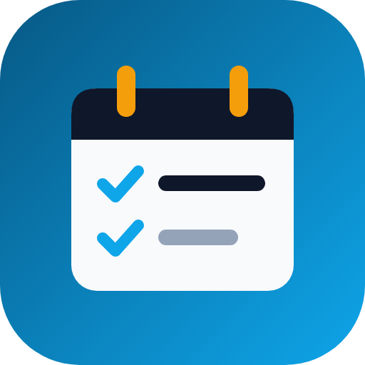

# Meeting Assistant — مساعد الاجتماعات لـClaude

**العربية** | [English](#english)

بلغن يجعل Claude يكتب **محضر الاجتماع** (القرارات، المهام بأصحابها ومواعيدها، الأسئلة المفتوحة)، ويجهّز رسالة المتابعة، و**يجدول الاجتماعات** على تقويمك. يعمل مع اجتماعات Zoom و Google Meet و Microsoft Teams.

**القاعدة: Claude يُعدّ وأنت تعتمد.** لا تُرسل رسالة ولا يُنشأ موعد ولا يُعدَّل ولا يُلغى إلا بعد «نعم» منك على ذلك الشيء بعينه.

| الملف | ما هو |
|---|---|
| [meeting-assistant-0.1.0.plugin](https://github.com/moutaz990/Prevaro-Add-ons-for-Claude/raw/main/meeting-assistant/meeting-assistant-0.1.0.plugin) | البلغن نفسه: مهارتان، بلا أي ربط |
| [connect-fathom-0.1.0.plugin](https://github.com/moutaz990/Prevaro-Add-ons-for-Claude/raw/main/meeting-assistant/connect-fathom-0.1.0.plugin) | ربط Fathom بتسجيل الدخول (اختياري) |
| [connect-fireflies-0.1.0.plugin](https://github.com/moutaz990/Prevaro-Add-ons-for-Claude/raw/main/meeting-assistant/connect-fireflies-0.1.0.plugin) | ربط Fireflies بمفتاح API (اختياري) |
| [connect-zoho-mail-0.1.0.plugin](https://github.com/moutaz990/Prevaro-Add-ons-for-Claude/raw/main/meeting-assistant/connect-zoho-mail-0.1.0.plugin) | ربط Zoho Mail بعنوان خادمك من لوحة Zoho (اختياري) |

> **الحالة:** كل البلغنز تجتاز فحص `claude plugin validate`، وتثبيت إضافتي Fireflies و Zoho Mail مع إدخال المفتاح والعنوان جُرّب في Claude Code. لم يُجرَّب شيء بعد داخل Claude Desktop حقيقي، ولا مع حسابات حقيقية في Fathom أو Fireflies أو Zoho أو أي تقويم. أخبرنا في [Issues](https://github.com/moutaz990/Prevaro-Add-ons-for-Claude/issues) إن واجهت مشكلة.

## مهم: Claude لا يدخل الاجتماع

Claude لا يستطيع أن يدخل مكالمة Zoom أو Meet أو Teams، ولا أن يسمع أو يسجّل. شيء آخر يصنع التسجيل والنص، و Claude يقرؤه بعد الاجتماع ويكتب منه المحضر:

| من يسجّل | كيف يدخل الاجتماع | كيف يقرأ Claude الناتج |
|---|---|---|
| **Fathom** أو **Fireflies** (مدوّن اجتماعات) | يدخل مكالماتك على Zoom و Meet و Teams كمشارك، من تقويمك | إضافة `connect-fathom` أو `connect-fireflies`، أو صفحة الموصلات في التطبيق |
| **Zoom** نفسه | تسجيل Zoom وملخصه الذكي، تفعّله في الاجتماع | موصل Zoom الرسمي في صفحة الموصلات بتطبيق Claude |
| **Microsoft Teams** نفسه | تفريغ Teams، تفعّله في الاجتماع | موصل Microsoft 365. يلزم أن يسمح مدير النظام بقراءة التفريغ أولاً |
| **Google Meet** نفسه | تفريغ Meet، تفعّله في الاجتماع | النص يُحفظ مستنداً في Google Drive، وموصل Google Drive يقرؤه |

مدوّن واحد يغطي المنصات الثلاث، وهذا أبسط إعداد إن كانت اجتماعاتك موزعة بينها. وبلا أي ربط يعمل البلغن أيضاً: تلصق النص أو ملاحظاتك فيكتب المحضر.

## ماذا يضيف إلى Claude؟

| المهارة | ماذا تفعل | اطلبها هكذا |
|---|---|---|
| `meeting-minutes` | محضر من نص الاجتماع أو ملاحظاتك: قرارات، مهام بأصحابها ومواعيدها، أسئلة مفتوحة، ومسودة رسالة المتابعة | «اكتب محضر اجتماع اليوم مع المورد» |
| `meeting-scheduler` | يجد وقتاً في تقويمك، يكتب الدعوة بجدول أعمال، وينشئ الموعد بعد موافقتك | «جدوِل اجتماع المتابعة الأسبوع القادم» |

**ما يلتزم به المحضر:**
- كل قرار وكل مهمة لها أصل في النص، ويُقتبس عند السؤال.
- المسؤول أو الموعد الذي لم يُذكر في الاجتماع يُكتب `[TBC]` ولا يُخمَّن.
- المقاطع غير الواضحة في التسجيل تُعلَّم ويُسأل عنها. التفريغ الآلي للعربية، وللعربية المخلوطة بالإنجليزية، يخطئ كثيراً في الأسماء والأرقام والتواريخ.
- العناوين بالعربية والإنجليزية، وتستطيع وضع قالب مؤسستك مكانها.

## أي مدوّن تختار؟

فُحصت في 19 نوفمبر 2026 من مواقع مقارنة لا من صفحات الأسعار نفسها. الباقات تتغير كثيراً: راجع صفحة التسعير عند كل أداة قبل الاعتماد على أي شيء هنا.

| | Fathom | Fireflies |
|---|---|---|
| باقة مجانية | نعم | نعم |
| التسجيل في المجاني | يُذكر أنه بلا حد | يُذكر أنه محدود، والمصادر تختلف في الحد |
| ربط Claude في المجاني | يُذكر أنه متاح | يُذكر أنه متاح بحدود أقل |
| يدخل | Zoom، Google Meet، Teams | Zoom، Google Meet، Teams وغيرها |
| طريقة ربط Claude | تسجيل دخول | مفتاح API، أو تسجيل دخول |
| العربية | **غير مؤكدة** | **غير مؤكدة** |

**العربية هي الفيصل.** لم نستطع التأكد من أي من الشركتين أن العربية، أو العربية المخلوطة بالإنجليزية، تُفرَّغ جيداً. سجّل اجتماعاً حقيقياً واحداً بكل أداة على باقتها المجانية واقرأ النص قبل أن تختار.

## كيف تربط كل شيء

| ما تربطه | ما تدخله | أين |
|---|---|---|
| Fathom | لا شيء: تسجّل الدخول في صفحة Fathom | إضافة `connect-fathom`، أو صفحة الموصلات في التطبيق |
| Fireflies | مفتاح API من Settings ← Developer Settings | إضافة `connect-fireflies` |
| Zoho Mail | عنوان خادمك من لوحة `mcp.zoho.com` | إضافة `connect-zoho-mail` |
| Zoom | تسجيل دخول | صفحة الموصلات في تطبيق Claude (موصل Zoom الرسمي) |
| Teams و Outlook | تسجيل دخول | صفحة الموصلات: Microsoft 365 |
| Google Meet (النصوص) والتقويم | تسجيل دخول | صفحة الموصلات: Google Drive و Google Calendar |

**في Claude Code** (مثال Fireflies، ومثله البقية):
```
/plugin marketplace add moutaz990/Prevaro-Add-ons-for-Claude
/plugin install connect-fireflies@prevaro-addons
```
يسألك Claude عن المفتاح مرة واحدة ويحفظه في التخزين الآمن لنظامك. ولـFathom: بعد التثبيت شغّل `/mcp` واختر fathom ثم Authenticate.

**Zoho Mail خطوة بخطوة:** ادخل `mcp.zoho.com` بحسابك ← أنشئ خادم MCP ← أضف أدوات Zoho Mail التي تريدها (القراءة والبحث تكفيان غالباً، واترك الإرسال خارجها) ← انسخ العنوان من قسم Connect ← الصقه عند تثبيت `connect-zoho-mail`. عامل العنوان ككلمة سر.

## التسجيل وإذن الحاضرين

- أخبر كل من في الاجتماع أنه يُسجَّل ويُفرَّغ، وبأي أداة. هذا مطلوب نظاماً في أماكن كثيرة، وهو الصواب في كل مكان. مهارة الجدولة تضيف هذا التنبيه إلى الدعوة.
- المدوّن يحفظ التسجيل والنص على خوادمه. في اجتماعات العملاء تأكد أن هذا مقبول لمؤسستك ولهم.
- لا تستخدم شيئاً من هذا لتسجيل الناس دون علمهم.

## التثبيت

**تطبيق Claude Desktop (Cowork):** نزّل [meeting-assistant-0.1.0.plugin](https://github.com/moutaz990/Prevaro-Add-ons-for-Claude/raw/main/meeting-assistant/meeting-assistant-0.1.0.plugin)، وارفعه من قسم البلغنز (Customize ← Plugins) أو اسحبه إلى محادثة Cowork واقبله. أسماء القوائم قد تختلف حسب إصدار التطبيق.

**Claude Code:**
```
/plugin marketplace add moutaz990/Prevaro-Add-ons-for-Claude
/plugin install meeting-assistant@prevaro-addons
```

---

## English

A plugin that makes Claude write the **minutes of a meeting** (decisions, action items with owners and dates, open questions), draft the follow-up message, and **schedule meetings** on your calendar. It works with Zoom, Google Meet and Microsoft Teams meetings.

**The rule: Claude prepares, you approve.** No message is sent and no event is created, changed or cancelled until you say yes to that specific thing.

| File | What it is |
|---|---|
| [meeting-assistant-0.1.0.plugin](https://github.com/moutaz990/Prevaro-Add-ons-for-Claude/raw/main/meeting-assistant/meeting-assistant-0.1.0.plugin) | The plugin itself: 2 skills, no connections |
| [connect-fathom-0.1.0.plugin](https://github.com/moutaz990/Prevaro-Add-ons-for-Claude/raw/main/meeting-assistant/connect-fathom-0.1.0.plugin) | Fathom connection by sign-in (optional) |
| [connect-fireflies-0.1.0.plugin](https://github.com/moutaz990/Prevaro-Add-ons-for-Claude/raw/main/meeting-assistant/connect-fireflies-0.1.0.plugin) | Fireflies connection with an API key (optional) |
| [connect-zoho-mail-0.1.0.plugin](https://github.com/moutaz990/Prevaro-Add-ons-for-Claude/raw/main/meeting-assistant/connect-zoho-mail-0.1.0.plugin) | Zoho Mail connection with your server address from Zoho's console (optional) |

> **Status:** every plugin passes `claude plugin validate`, and installing the Fireflies and Zoho Mail add-ons with a key and an address was tried in Claude Code. Nothing has yet been tried inside a real Claude Desktop install, or with real Fathom, Fireflies, Zoho or calendar accounts. Please report problems in [Issues](https://github.com/moutaz990/Prevaro-Add-ons-for-Claude/issues).

### Important: Claude does not join the meeting

Claude cannot enter a Zoom, Meet or Teams call, listen or record. Something else makes the recording and the transcript; Claude reads it after the meeting and writes the minutes from it:

| Who records | How it gets into the meeting | How Claude reads the result |
|---|---|---|
| **Fathom** or **Fireflies** (a notetaker) | Joins your Zoom, Meet and Teams calls as a participant, from your calendar | `connect-fathom` or `connect-fireflies`, or the app's connectors page |
| **Zoom** itself | Zoom's own recording and AI summary, turned on in the meeting | Zoom's official connector in the Claude app's connectors page |
| **Microsoft Teams** itself | Teams' own transcription, turned on in the meeting | The Microsoft 365 connector. An administrator must allow transcript access first |
| **Google Meet** itself | Meet's own transcription, turned on in the meeting | The transcript is saved as a document in Google Drive; the Google Drive connector reads it |

One notetaker covers all three platforms, the simplest setup when your meetings are spread across them. With nothing connected the plugin still works: paste the transcript or your notes and it writes the minutes.

### What it adds

| Skill | What it does | Ask for it like this |
|---|---|---|
| `meeting-minutes` | Minutes from a transcript or your notes: decisions, action items with owners and dates, open questions, and a follow-up draft | "Write the minutes of today's meeting with the supplier" |
| `meeting-scheduler` | Finds a time on your calendar, drafts the invitation with an agenda, creates the event after your yes | "Schedule the follow-up for next week" |

What the minutes stick to: every decision and action is traceable to the record; an owner or a date that was not said is written `[TBC]`, never guessed; unclear passages are marked and asked about (automatic transcription of Arabic and of mixed Arabic and English is often wrong on names, numbers and dates); headings come in English and Arabic, and you can put your organisation's template in their place.

### Which notetaker?

Checked on 19 November 2026 from comparison sites, not from the vendors' own pricing pages. Plans change often: read each vendor's pricing page before relying on anything here.

| | Fathom | Fireflies |
|---|---|---|
| Free plan | Yes | Yes |
| Recording on the free plan | Reported as unlimited | Reported as limited; sources disagree on the limit |
| Claude connection on the free plan | Reported as included | Reported as included, with lower limits |
| Joins | Zoom, Google Meet, Teams | Zoom, Google Meet, Teams and others |
| How Claude connects | Sign-in | API key, or sign-in |
| Arabic | **Not confirmed** | **Not confirmed** |

**Arabic is the deciding point.** We could not confirm from either vendor that Arabic, or mixed Arabic and English, is transcribed well. Record one real meeting with each on its free plan and read the transcript before you choose.

### How to connect everything

| What you connect | What you enter | Where |
|---|---|---|
| Fathom | Nothing: you sign in on Fathom's page | `connect-fathom`, or the app's connectors page |
| Fireflies | An API key from Settings → Developer Settings | `connect-fireflies` |
| Zoho Mail | Your server address from the `mcp.zoho.com` console | `connect-zoho-mail` |
| Zoom | Sign-in | The Claude app's connectors page (Zoom's official connector) |
| Teams and Outlook | Sign-in | Connectors page: Microsoft 365 |
| Google Meet (transcripts) and calendar | Sign-in | Connectors page: Google Drive and Google Calendar |

In Claude Code (Fireflies shown; the others are the same):
```
/plugin marketplace add moutaz990/Prevaro-Add-ons-for-Claude
/plugin install connect-fireflies@prevaro-addons
```
Claude asks for the key once and keeps it in your system's secure storage. For Fathom, after installing run `/mcp`, choose fathom, then Authenticate.

**Zoho Mail step by step:** sign in at `mcp.zoho.com` → create an MCP server → add the Zoho Mail tools you want (reading and searching are usually enough; leave sending out) → copy the address under Connect → paste it when installing `connect-zoho-mail`. Treat the address like a password.

### Recording and consent

- Tell everyone in the meeting that it is being recorded and transcribed, and by which tool. In many places this is a legal requirement, and it is right everywhere. The scheduler skill adds the notice to invitations.
- A notetaker stores the recording and the transcript on its own servers. For meetings with customers, check that this is acceptable for your organisation and for them.
- Never use any of this to record people without their knowledge.

### Install

**Claude Desktop (Cowork):** download `meeting-assistant-0.1.0.plugin` above, then upload it in the app's plugins section (Customize → Plugins) or drop it into a Cowork chat and accept it. Menu names may differ between app versions.

**Claude Code:**
```
/plugin marketplace add moutaz990/Prevaro-Add-ons-for-Claude
/plugin install meeting-assistant@prevaro-addons
```
